<div align="center">

<a href="https://msreeganeshnaik.github.io/Apollo-11-Anatomy./">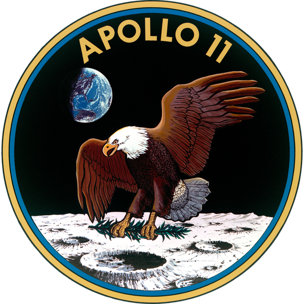</a>

# Apollo 11 Anatomy

**Saturn V AS-506 &nbsp;·&nbsp; *Columbia* CSM-107 &nbsp;·&nbsp; *Eagle* LM-5**

An interactive 3D technical drawing of the rocket and spacecraft that landed on the Moon.<br />
Fire every engine, take any stage apart, look inside the cabins, and fly the whole mission on a to-scale map.

[](https://msreeganeshnaik.github.io/Apollo-11-Anatomy./)

[](https://threejs.org/)
[](https://www.khronos.org/webgl/)
[](dist/apollo.html)
[](#how-it-is-built)
[](LICENSE)

[**Live demo**](https://msreeganeshnaik.github.io/Apollo-11-Anatomy./) &nbsp;·&nbsp; [Tour](#the-tour) &nbsp;·&nbsp; [What's inside](#whats-inside) &nbsp;·&nbsp; [Run it](#run-it) &nbsp;·&nbsp; [How it's built](#how-it-is-built) &nbsp;·&nbsp; [The mission](#apollo-11-everything-you-need-to-know) &nbsp;·&nbsp; [Sources](#sources)

<br />

<a href="https://msreeganeshnaik.github.io/Apollo-11-Anatomy./">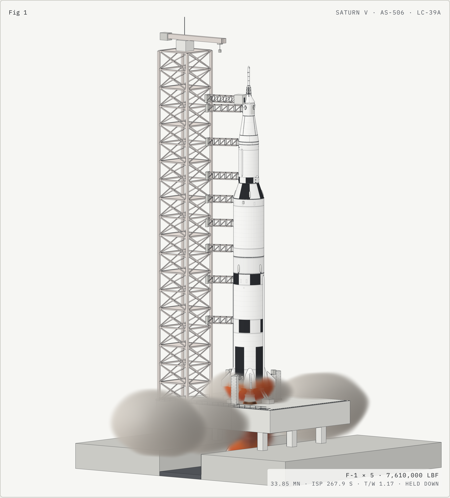</a>

<sub>Saturn V AS-506 at ignition on Launch Complex 39A: five F-1s at full thrust, still held down on the pad.</sub>

</div>

<br />

## The tour

<table>
<tr>
<td width="50%" valign="top">
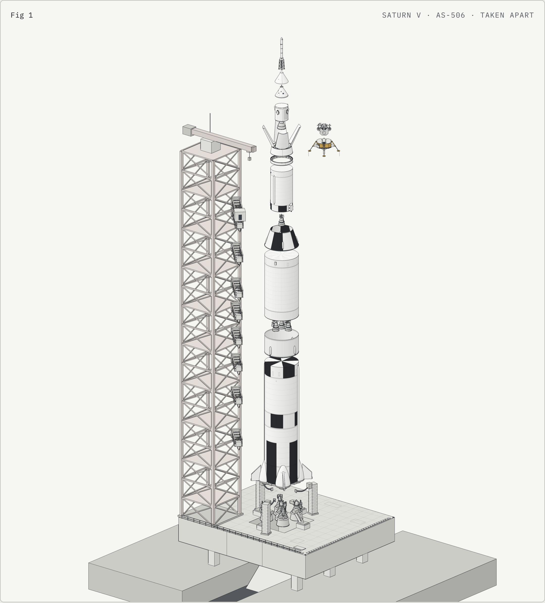
<p><b>Take the rocket apart.</b> One click opens the whole stack in place: escape tower, <i>Columbia</i>, the adapter, <i>Eagle</i>, all three stages and both interstages, every engine bell hanging clear of the part below it.</p>
</td>
<td width="50%" valign="top">
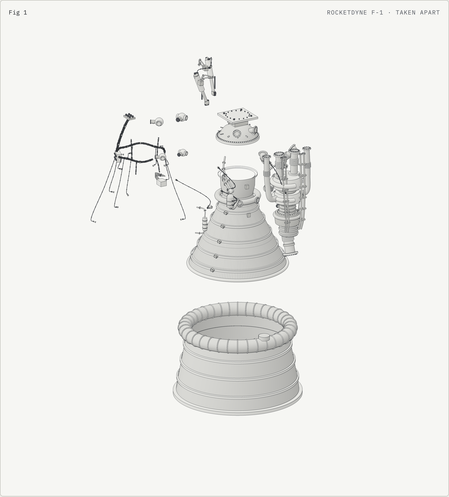
<p><b>Then take the engines apart.</b> The F-1, J-2, SPS, descent and ascent engines are drawn down to the turbopumps, ducts, valves and wiring, and each separates into its assemblies. Click one to zoom to it.</p>
</td>
</tr>
<tr>
<td colspan="2" valign="top">
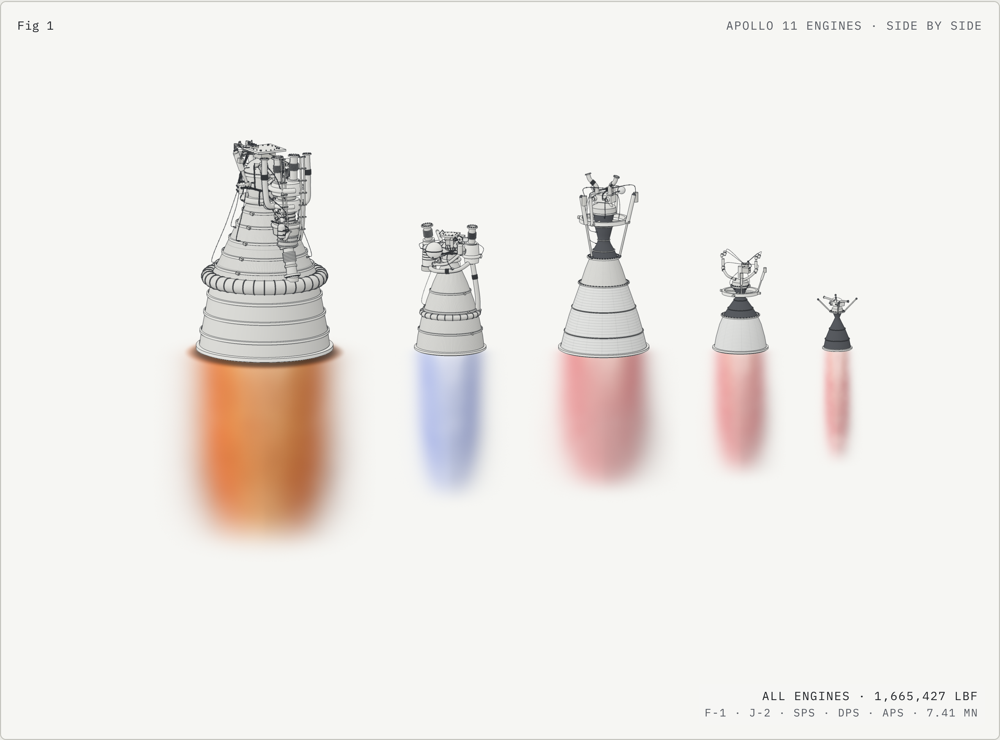
<p><b>Every engine, to one scale.</b> F-1, J-2, SPS, DPS and APS side by side with their nozzle exits on one line. Ignite them all, or fire and cut any one on its own. The plume colour follows the propellant: kerosene burns orange, hydrogen burns a faint blue, and the hypergolics burn a translucent rose.</p>
</td>
</tr>
<tr>
<td width="50%" valign="top">
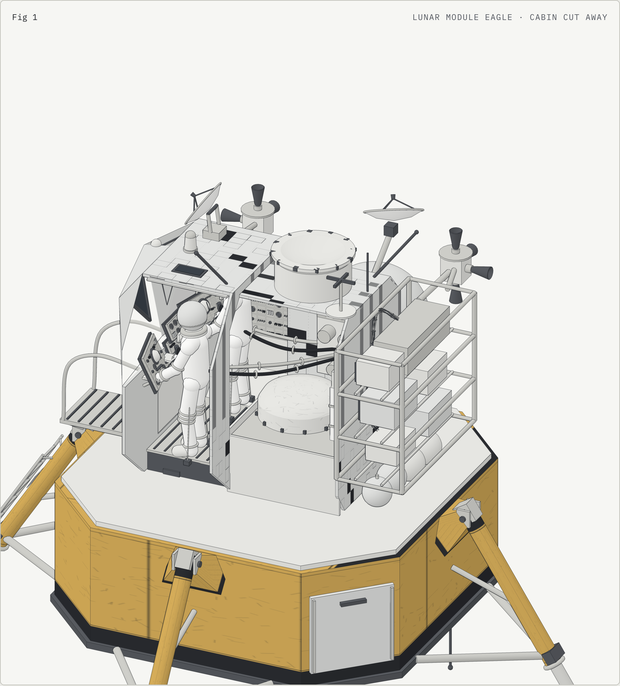
<p><b>Inside <i>Eagle</i>.</b> The right wall comes away to show Armstrong and Aldrin standing at the windows on their restraint cables, with the panels, the DSKY, the backpacks and the life-support gear.</p>
</td>
<td width="50%" valign="top">
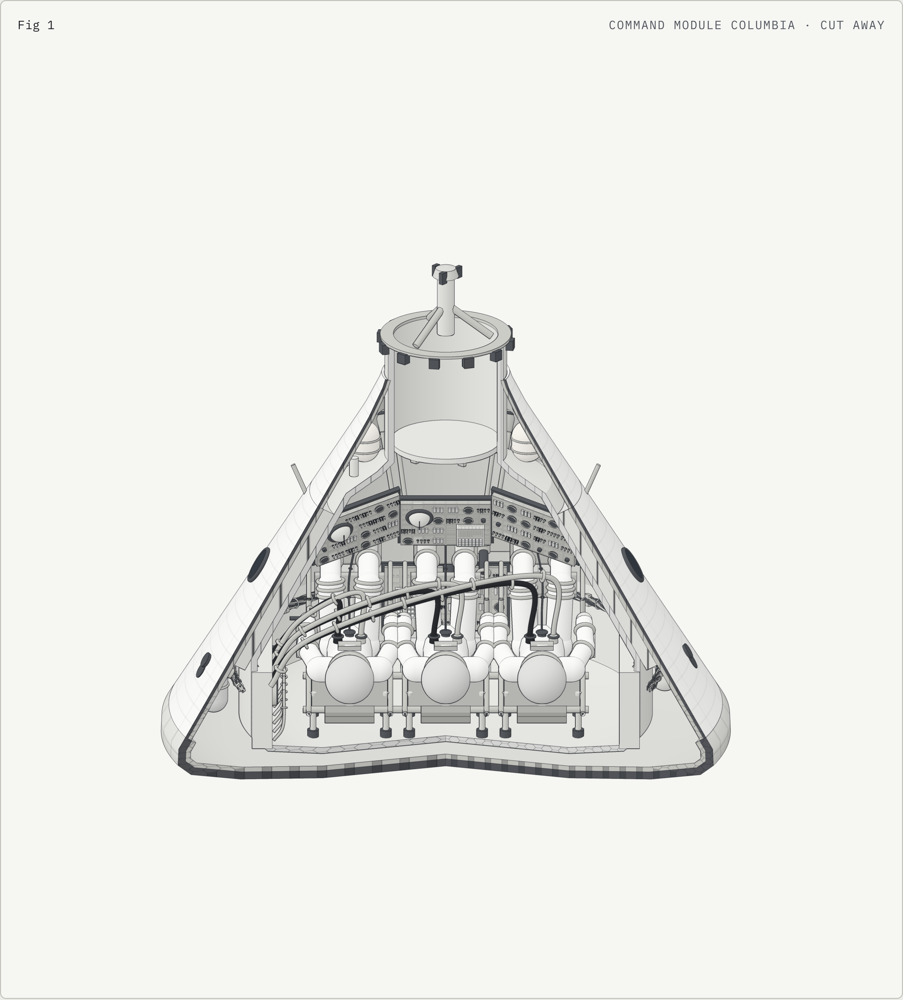
<p><b>Inside <i>Columbia</i>.</b> A 140° wedge cut out of the command module: the heat-shield layers in section, three suited crew on their couches, the main display console and the parachutes.</p>
</td>
</tr>
<tr>
<td colspan="2" valign="top">
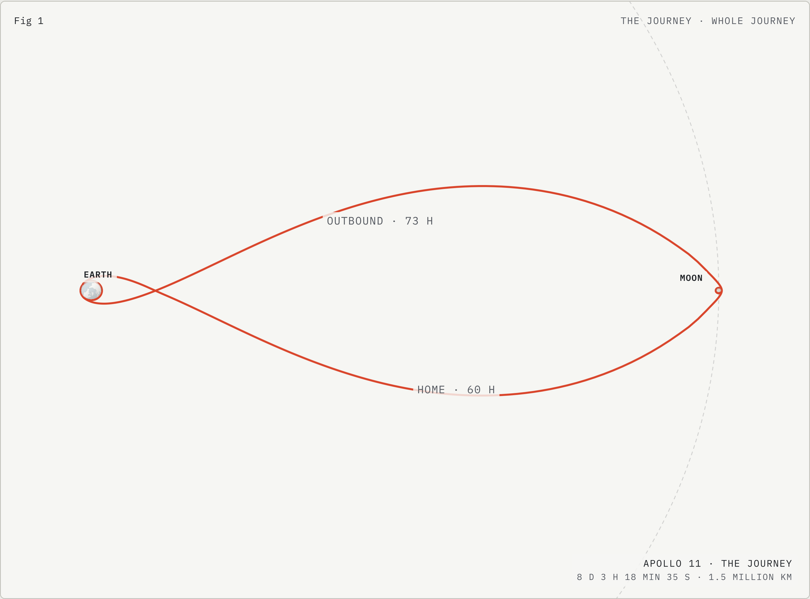
<p><b>Fly the whole mission.</b> Fifteen stages from liftoff to splashdown on an Earth–Moon map where the planets, their distance and every orbit are to scale. The globe has real coastlines and turns with mission time.</p>
</td>
</tr>
<tr>
<td width="50%" valign="top">
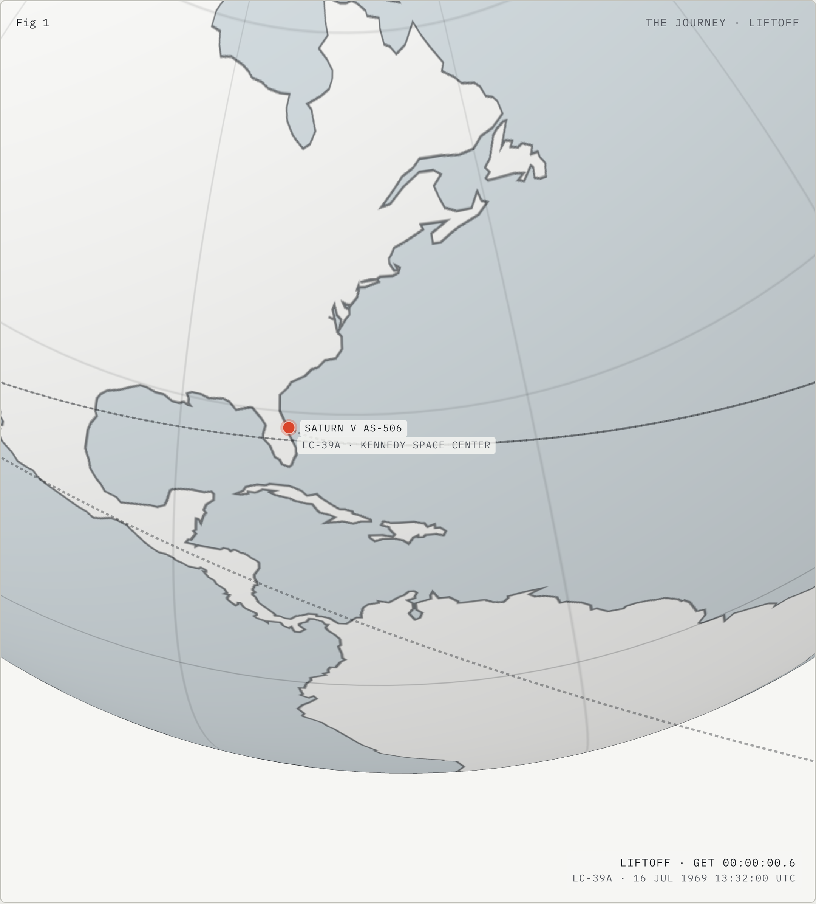
<p><b>Liftoff, 16 July 1969, 13:32 UTC.</b> The climb to orbit out over the Atlantic from Pad 39A.</p>
</td>
<td width="50%" valign="top">
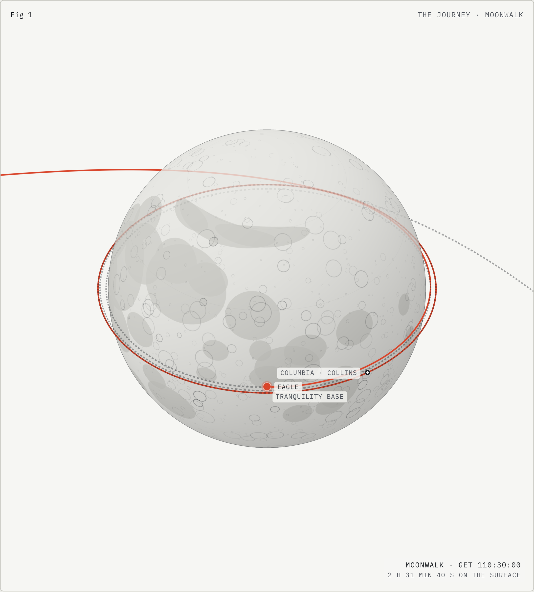
<p><b>Tranquility Base.</b> <i>Eagle</i> on the surface for the moonwalk while Collins keeps orbiting in <i>Columbia</i>.</p>
</td>
</tr>
</table>

<details>
<summary><b>One more: entry and splashdown</b></summary>
<br />
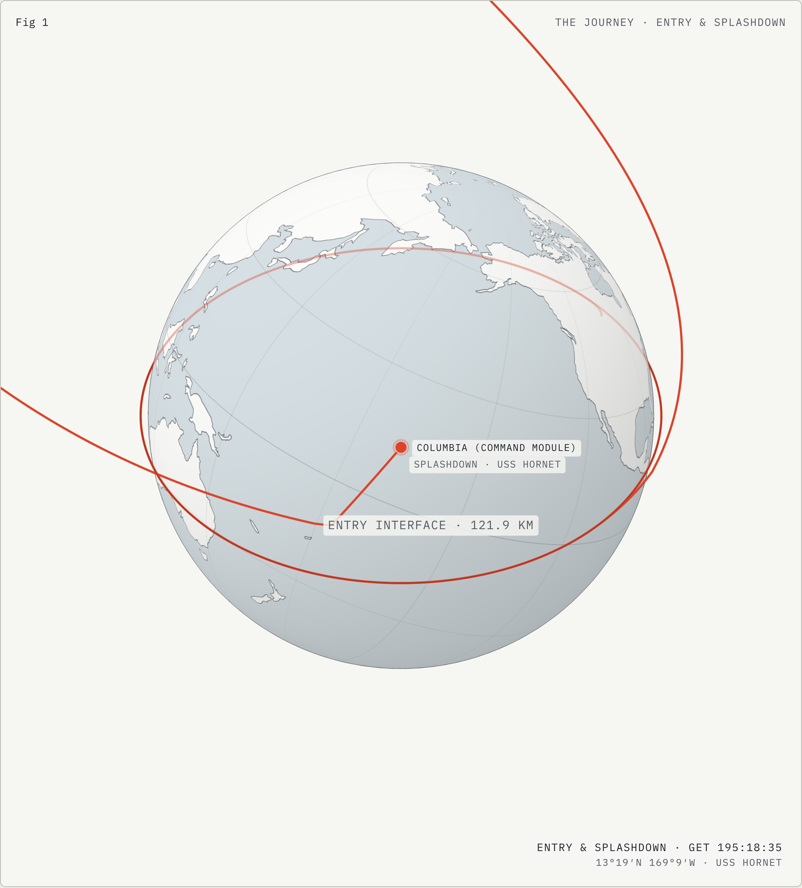
</details>

---

## What's inside

| Section | What's in it |
|---|---|
| **Overview** | The full stack on Launch Complex 39A: Mobile Launcher 1, the umbilical tower and its nine swing arms, hold-down arms, tail service masts and the flame trench. |
| **Stages** | S-IC, S-II, S-IVB, the Instrument Unit and both interstages. *Take apart* pulls the stack open in place, so every engine bell hangs clear of the part below it. |
| **Engines** | All six engine groups on the vehicle: 5 × F-1, 5 × J-2 (S-II), 1 × J-2 (S-IVB), the SPS, the descent engine and the ascent engine. Each fires with a live thrust readout, a throttle, an ambient-altitude slider and per-engine "engine out" toggles. |
| **Spacecraft** | Escape tower, boost protective cover, *Columbia* (CM + SM), the adapter and *Eagle* with both of its stages. Each item fires its own engine: the Service Module fires the SPS, Eagle fires the descent engine and the ascent stage fires the ascent engine. |
| **Detailed engines** | The F-1, J-2, SPS, DPS and APS on their own, drawn down to ducts, valves, turbopumps, transducers and wiring. *Take apart* separates each into its assemblies, and clicking an assembly zooms to it. |
| **All engines** | All five types side by side at true relative size, with their nozzle exits on one line. **Ignite all** fires the row, and the colour-coded engine buttons fire or cut any one engine on its own. |
| **Crew quarters** | *Columbia* with a 140° wedge cut away: heat-shield layers in section, three suited crew on their couches, the main display console and the parachutes. *Eagle* with its right wall cut away: two crew standing at the windows on restraint cables, the panels and DSKY, the backpacks and life support. |
| **The Journey** | Fifteen stages of the flight on an Earth–Moon map with Earth, Moon, their distance and every orbit to scale. A marker flies the path stage to stage. The globe has real coastlines and turns with mission time, and the Moon carries its maria and Tranquility Base. *Previous / Next* step through the flight. |

**Live numbers.** The thrust, Isp, propellant flow, chamber pressure and thrust-to-weight on the console are all computed. Thrust follows F = t·F<sub>vac</sub> − p<sub>a</sub>·A<sub>e</sub>, and ambient pressure comes from the U.S. Standard Atmosphere 1976. The descent engine obeys its real throttle limits: 10–60 % continuously, or full thrust.

**Plume colours follow the propellants:**
- the F-1 burns kerosene with liquid oxygen: bright orange inside a dark collar of fuel-rich turbine exhaust;
- the J-2 burns hydrogen with liquid oxygen: almost clear, a faint blue with shock diamonds;
- the SPS, DPS and APS all burn Aerozine 50 with nitrogen tetroxide: a translucent rose-orange.

<details>
<summary><b>Camera controls</b></summary>
<br />

Turn on *Free cam*, then:

| Input | Action |
|---|---|
| Drag | orbit (or pan, set by the Drag toggle) |
| Right- or Shift-drag | pan |
| Scroll / pinch | zoom |
| W / S, A / D, Q / E | fly in-out, sideways, down-up (Shift = faster) |
| Arrow keys | turn and tilt |
| R or ⟲ | reset the view |
| Space / Enter | ignite / shut down |
| [ / ] | throttle down / up |

</details>

---

## Run it

**Just view it:** go to the [live site](https://msreeganeshnaik.github.io/Apollo-11-Anatomy./), or download [`dist/apollo.html`](dist/apollo.html) and open it in a current Chrome, Edge, Safari or Firefox. It needs an internet connection the first time, to load three.js and the two fonts from their CDNs. It needs WebGL 2; if WebGL is off, the spec sheets still load.

**Serve it locally** (some browsers restrict module scripts on `file://`):

```bash
python3 -m http.server 8000
# then open http://localhost:8000/dist/apollo.html
```

**Build from source.** `dist/apollo.html` is generated; edit `src/` and rebuild:

```bash
npm install
npm run build          # src/ → dist/apollo.html
```

<details>
<summary><b>Headless screenshots, scripting, hosting</b></summary>
<br />

Playwright runs the page in Chromium with the SwiftShader software renderer, maps the three.js CDN to `node_modules`, runs a list of actions and saves screenshots plus the console output:

```bash
npx playwright install chromium   # once
npm run shot -- demo '[["wait",8000],["eval","APOLLO.selectItem(\"dALL\"); APOLLO.ignite(); APOLLO.warp(3)"],["el","lineup","#fig"]]' --noaa
# → shots/demo-lineup.png
```

Flags: `--w=1400 --h=1000` set the viewport, `--mobile` uses a 390 × 844 phone, `--dark` forces the dark scheme, `--noaa` turns anti-aliasing off (much faster in software rendering), and `--dpr=2` sets the pixel ratio.
The page exposes `window.APOLLO` for scripting: `selectItem(id)`, `ignite()`, `shutdown()`, `fireOne(i)`, `setExplode(on)`, `warp(seconds)`, `groupState()`, plus `MENU_ITEMS`, `SHOW`, `C`, `CAM`, `J`.

**Hosting.** GitHub Pages serves the `gh-pages` branch, which holds only the built site: the page as `index.html` (and again as `apollo.html`, so older links keep working) plus `.nojekyll`. After changing `main`, publish with `npm run deploy`, which builds and pushes `dist/apollo.html` there.

**Regenerate the coastlines** (only if you want a different Natural Earth resolution): `npm run land`.

</details>

---

## How it is built

`scripts/build.mjs` concatenates every `src/**/NN-*.js`, in NN order, into one ES module. It inlines `src/page/style.css`, `src/page/body.html` and the tab icons and writes one standalone page, `dist/apollo.html`. three.js r0.160 is imported straight from jsDelivr. There are no frameworks and no other runtime dependencies.

```text
Apollo-11-Anatomy./
├── dist/
│   └── apollo.html            the built page: one file, open it and it runs
├── src/
│   ├── page/                  style.css · body.html · favicon.png · apple-touch-icon.png
│   ├── core/                  00-head · 20-render · 30-geom · 42-showkit
│   ├── data/                  05-land · 10-data
│   ├── models/                40-vehicle · 41-spacecraft · 43-detail-engines · 44-cabins · 46-lm
│   ├── scenes/                45-showroom · 47-journey
│   └── app/                   50-controller · 60-ui · 70-main
├── scripts/                   build.mjs · shot.mjs · make-land.mjs · deploy.sh
├── docs/images/               apollo-11-emblem.png · screenshots/
├── package.json
├── LICENSE
└── README.md
```

| File | Role |
|---|---|
| `src/core/00-head.js` | three.js import, maths helpers |
| `src/core/20-render.js` | The technical-illustration pipeline, toon materials, procedural canvas textures, and the volumetric exhaust shader with its colour sets |
| `src/core/30-geom.js` | Geometry kit: lathe profiles (`turn`), rods, modules |
| `src/core/42-showkit.js` | Helpers for the detailed displays: merged geometry, ducts, cables, bolt circles, flanges, valves |
| `src/data/05-land.js` | Natural Earth 1:110m coastlines (70 rings, ~4,600 points) for the Earth texture |
| `src/data/10-data.js` | **Every number on the page.** Engine ratings, stage and module specs, the U.S. Standard Atmosphere 1976, the as-flown ascent table, mission events, the parts index and sources |
| `src/models/40-vehicle.js` | Launcher, tower and swing arms, S-IC, S-II, S-IVB, IU and the engine clusters |
| `src/models/41-spacecraft.js` | SLA with hinged panels, Service Module, Command Module, BPC, escape tower |
| `src/models/43-detail-engines.js` | F-1, J-2, SPS, DPS and APS built to the plumbing, each split into assemblies |
| `src/models/44-cabins.js` | *Columbia* and *Eagle* cutaways with posed crew |
| `src/models/46-lm.js` | *Eagle*, built from the LM-5 structures dimensions: cabin, midsection, tunnel, tanks, antennas, RCS quads, legs, probes, ladder, porch |
| `src/scenes/45-showroom.js` | Registers the displays, the **All engines** row and the depth range for each display |
| `src/scenes/47-journey.js` | **The Journey**: conic trajectories, the turning Earth, textures for Earth and Moon, screen-space path lines, labels |
| `src/app/50-controller.js` | State, engine physics per frame, take-apart poses, camera framing |
| `src/app/60-ui.js` | Console, live readouts, stacked parts index, spec sheets |
| `src/app/70-main.js` | Boot, picking, the frame loop |
| `scripts/build.mjs` | Builds `dist/apollo.html` (`npm run build`) |
| `scripts/shot.mjs` | Headless screenshots and checks (`npm run shot`) |
| `scripts/make-land.mjs` | Regenerates `src/data/05-land.js` (`npm run land`) |
| `scripts/deploy.sh` | Publishes the built page to GitHub Pages (`npm run deploy`) |

The two-digit prefixes set the order the parts are joined in, so a file can move between folders without changing the build.

<details>
<summary><b>Rendering pipeline</b></summary>
<br />

1. **Normals, part id and depth.** One pass draws every visible part's surface normal, part id and depth into a render target.
2. **Colour.** A second pass draws the paper-tone "toon" colour with 4× MSAA.
3. **Ink.** A composite pass draws the ink lines wherever the normal bends sharply, the part id changes or the depth jumps. The result reads like a hand-inked technical drawing rather than a shaded model.
4. **Exhaust and overlays.** Plumes, steam and pad fire are raymarched volumes, 26 steps per pixel, stopped by the scene depth so nozzles and decks hide the flame correctly. The Journey's path lines are drawn in this pass too, as screen-space ribbons that dim behind the planets.

**Anti-aliasing.** With it on, the scene renders at up to 2× the device resolution within a pixel budget and is box-filtered down. The budget is 10 MP on desktops and 16 MP on phones and tablets, so phones always get the full 2×. The only cap is the GPU's largest render buffer.

**Depth precision.** The camera's near and far planes hug the bounding sphere of whatever is on show. Phone GPUs read depth at half precision, and a wide depth range made the ink pass draw contour bands across smooth surfaces.

**Smoothness:**
- Frames are skipped when nothing on screen can have changed.
- The labels and controls over the drawing never overlap: the controls and the readout share one bar that wraps, and every view is framed inside the clear area between the top labels and the bottom bar.
- The live panel writes to the page only when a value changes, so an idle page does no layout or paint work.
- Every shader, exhaust included, compiles in idle time after load, so the first *Ignite* doesn't stall.
- On desktops the Journey map is built in idle time; on phones it is built on first visit.

</details>

<details>
<summary><b>Physics</b></summary>
<br />

- **Thrust:** F(t, p<sub>a</sub>) = t · F<sub>vac</sub> − p<sub>a</sub> · A<sub>e</sub>. Momentum thrust scales with mass flow; the pressure term does not.
- **F-1 exit area** comes from its rated pair: A<sub>e</sub> = (1,746,000 − 1,522,000) lbf × 4.44822 N/lbf ÷ 101,325 Pa ≈ 9.83 m², which is an exit diameter of about 3.54 m.
- **F-1 mass flow** is 1,789 kg/s of LOX plus 788 kg/s of RP-1, 2,577 kg/s in all. That gives Isp ≈ 268 s at sea level and ≈ 307 s in vacuum, against ratings of 263 / 304 s.
- **J-2 thrust** is taken linearly in ambient pressure between its sea-level and vacuum ratings.
- **SPS, DPS and APS** run at their vacuum design points.
- **Liftoff thrust-to-weight:** 5 × 6,770 kN ÷ (2,938,315 kg × 9.80665 m/s²) ≈ 1.17.
- **Ambient pressure** comes from the U.S. Standard Atmosphere 1976, seven layers to 86 km, with vacuum above.
- **The Journey, near Earth:** the coasts are Earth-centred ellipses timed with Kepler's equation from the TLI and entry conditions (perigee 322.7 km after TLI, entry interface 121.9 km).
- **The Journey, near the Moon:** within about 40,000 km of the Moon the path blends into a lunar hyperbola that reaches periselene 111 km on the far side.
- **The Journey, frame:** everything is carried into the frame that turns with the Moon (one turn every 27.3 days). That is why the flight closes into the famous figure-8.

</details>

---

## Apollo 11: everything you need to know

Apollo 11 was the first crewed landing on another world. Neil Armstrong and Buzz Aldrin landed the Lunar Module *Eagle* in the Sea of Tranquility on 20 July 1969, while Michael Collins orbited overhead in *Columbia*. All three returned safely on 24 July 1969, meeting the goal President Kennedy set in 1961 of landing a man on the Moon and returning him safely to Earth before the decade was out.

### At a glance

| | |
|---|---|
| Launch | 16 July 1969, 13:32:00 UTC (09:32 EDT), Launch Complex 39A, Kennedy Space Center |
| Launch vehicle | Saturn V SA-506 (AS-506) |
| Spacecraft | Command/Service Module CSM-107 *Columbia*; Lunar Module LM-5 *Eagle* |
| Vehicle height | 110.6 m (363 ft) to the escape-tower tip |
| Liftoff mass | 2,938,315 kg (6,477,875 lb) |
| Liftoff thrust | 7,610,000 lbf rated (5 × 1,522,000 lbf) |
| Earth parking orbit | 185.9 × 183.2 km |
| Lunar orbit | 100.9 × 122.4 km, 30 orbits |
| Landing | 20 July 1969, 20:17:40 UTC, Tranquility Base, 0°40′27″N 23°28′23″E |
| First step on the Moon | 21 July 1969, 02:56 UTC |
| Moonwalk | 2 h 31 min 40 s |
| Samples returned | 21.55 kg (47.5 lb) |
| Lunar liftoff | 21 July 1969, 17:54:00 UTC |
| Splashdown | 24 July 1969, 16:50:35 UTC, 13°19′N 169°9′W, recovered by USS *Hornet* |
| Mission duration | 8 d 3 h 18 min 35 s (195:18:35 ground elapsed time) |

### The crew

| | Role | Where |
|---|---|---|
| **Neil A. Armstrong** | Commander | Flew *Eagle* to the surface; first person to walk on the Moon |
| **Edwin E. "Buzz" Aldrin Jr.** | Lunar Module Pilot | Second on the surface, about twenty minutes later |
| **Michael Collins** | Command Module Pilot | Flew *Columbia* alone in lunar orbit, passing behind the Moon out of contact every two hours |

### The vehicle, stage by stage

| Part | Built by | Key figures |
|---|---|---|
| **S-IC first stage** | Boeing, Michoud | 42.06 m tall, 10.09 m wide. 130,422 kg empty, 2,131,322 kg loaded (770,000 L RP-1, 1,204,000 L LOX). 5 × F-1. Centre engine off at 135.2 s, outboards at 161.6 s, 66 km up |
| **S-II second stage** | North American, Seal Beach | 24.87 m tall, 10.09 m wide. 36,158 kg dry, 479,964 kg loaded. A single common bulkhead between LH₂ and LOX. 5 × J-2. Burned T+2:43.0 → 9:08.2; centre engine 205 off early at T+7:40.6 |
| **S-IVB third stage** | Douglas, Huntington Beach | 17.86 m tall, 6.60 m wide. 11,273 kg dry, 119,119 kg loaded. One restartable J-2: 150 s to orbit, then 347 s for trans-lunar injection |
| **Instrument Unit** | IBM, Huntsville | A 0.91 m ring holding the Saturn V's guidance computer, inertial platform and telemetry. It steered all three stages |
| **Spacecraft–LM Adapter** | | 8.53 m long, tapering 6.60 → 3.91 m. *Eagle* rode inside with its legs folded; the four panels hinged open and were thrown clear |
| **Service Module** | North American, Downey | 4.52 m body (7.49 m with nozzle), 3.91 m wide, 24,520 kg. SPS 20,500 lbf, three fuel cells, four RCS quads, high-gain antenna |
| **Command Module *Columbia*** | North American, Downey | 3.48 m tall, 3.91 m base, 5,560 kg, 5.9 m³ habitable. Phenolic ablator heat shield 1.3–5.1 cm thick, 12 RCS thrusters, three 25.5 m ringsail main parachutes |
| **Launch Escape System** | | 10.06 m, ≈3,630 kg. Escape motor ≈147,000 lbf for 3.2 s. Jettisoned at T+3:17.9 together with the boost protective cover |
| **Lunar Module *Eagle*** | Grumman | 6.99 m tall, 9.4 m across the legs, 15,102 kg at launch. Descent stage: TRW throttleable engine, ≈8,200 kg propellant, four legs with 37 in footpads and contact probes on three. Ascent stage: 92 in pressurised cabin, Bell ascent engine, 16 RCS thrusters in four quads |

### The engines

| Engine | Where | On AS-506 | Thrust (lbf) | Isp (s) | Propellants | Notes |
|---|---|---|---|---|---|---|
| **Rocketdyne F-1** | S-IC | 5 | 1,522,000 SL · 1,746,000 vac | 263 SL · 304 vac | RP-1 / LOX | 70 bar chamber, 2.27 : 1 mixture, 16 : 1 expansion, ≈55,000 bhp turbopump, 8,400 kg. Still the most powerful single-chamber liquid engine flown |
| **Rocketdyne J-2** | S-II, S-IVB | 6 | 109,302 SL · 232,250 vac | 200 SL · 421 vac | LH₂ / LOX | 52.6 bar, 5.5 : 1 mixture, 27.5 : 1 expansion, 1,788 kg. Restartable once, for TLI |
| **Aerojet AJ10-137 (SPS)** | Service Module | 1 | 20,500 vac | 314.5 | Aerozine 50 / N₂O₄ | Hypergolic, gimballed in two axes. Did lunar orbit insertion and trans-Earth injection |
| **TRW descent engine (DPS)** | LM descent stage | 1 | 1,050 – 10,125 | 311 | Aerozine 50 / N₂O₄ | The only throttleable engine on Apollo: 10–60 % continuously, or full thrust |
| **Bell ascent engine (APS)** | LM ascent stage | 1 | 3,500 | 311 | Aerozine 50 / N₂O₄ | Pressure-fed, no gimbal, no throttle. One start that had to work |

### The journey, stage by stage

1. **Liftoff (00:00:00.6).** Five F-1s lift 2,938 t off Pad 39A. The vehicle clears the tower in about 12 seconds, rolls onto its flight azimuth and pitches out over the Atlantic.
2. **Climb to orbit (to 00:11:49.3).**
   - The S-IC burns out at 2 min 42 s, 66 km up, and the S-II takes over.
   - The escape tower goes at 3 min 18 s.
   - The S-II cuts off at 9 min 8 s.
   - The S-IVB's J-2 shuts down at 11 min 39 s, at 25,562 ft/s.
3. **Earth parking orbit (185.9 × 183.2 km).** About 1.5 laps of 88 minutes each, while the crew and Houston check every system before committing to the Moon.
4. **Trans-lunar injection (02:44:16 → 02:50:03).** Over the Pacific the S-IVB relights for 5 min 47 s, raising the speed from 25,554 to 35,563 ft/s.
5. **Transposition and docking (03:17 → 04:17).**
   - *Columbia* separates and the adapter panels fall away.
   - Collins turns the CSM round and docks nose-to-nose with *Eagle*.
   - The joined spacecraft pull *Eagle* out of the S-IVB.
6. **Translunar coast (≈73 h).** Earth's gravity slows the spacecraft for three days. A slow "barbecue roll" spreads the Sun's heat, and one midcourse correction trims the path (26:44:58, ≈20.9 ft/s). The Moon's pull takes over at about 61:40 GET.
7. **Lunar orbit insertion (75:49:49.6).** Behind the Moon and out of radio contact, the SPS fires for about six minutes (≈2,924 ft/s). A second burn at 80:11:36 rounds off the orbit.
8. **Eagle undocks (100:13:38).** It happens on the thirteenth orbit. "The Eagle has wings."
9. **Powered descent and touchdown (102:33:04 → 102:45:43).**
   - Descent orbit insertion drops *Eagle* to about 15 km.
   - The descent engine then burns for 12½ minutes.
   - Through 1202 and 1201 program alarms from the guidance computer, Armstrong takes manual control to fly past a boulder field. He lands with about 98 kg of usable propellant left.
   - "Houston, Tranquility Base here. The *Eagle* has landed."
10. **Moonwalk (2 h 31 min 40 s).**
    - Armstrong steps off the footpad at 02:56 UTC on 21 July: "That's one small step for [a] man, one giant leap for mankind." Aldrin follows about twenty minutes later.
    - They plant the flag and deploy the experiments.
    - They collect 21.55 kg of samples.
11. **Lunar liftoff (124:22:00).** The ascent engine burns for 434 s (≈6,055 ft/s). The descent stage stays behind as the launch pad.
12. **Rendezvous and docking (128:03).** *Eagle* catches *Columbia* from below over nearly two orbits. The crew and samples transfer, and the ascent stage is jettisoned at 130:09:55.
13. **Trans-Earth injection (135:23:42).** The SPS fires behind the Moon (≈3,293 ft/s) and sends *Columbia* home.
14. **Trans-Earth coast (≈59.7 h).** The spacecraft climbs out of the Moon's pull, then falls toward Earth, gaining speed the whole way.
15. **Entry and splashdown.**
    - The service module separates at 194:49:19.
    - Entry interface comes at 195:03:06, at 121.9 km and 36,194 ft/s.
    - The capsule passes through radio blackout, then three main parachutes open.
    - Splashdown is at 195:18:35, 13°19′N 169°9′W, near USS *Hornet*.

<details>
<summary><b>Flight record (ground elapsed time)</b></summary>
<br />

| GET | Event | Logged |
|---|---|---|
| 00:00:00.6 | Liftoff | LC-39A, 16 Jul 1969 13:32:00 UTC |
| 00:02:15.2 | S-IC centre engine cutoff | 145,600 ft · 6,504.5 ft/s |
| 00:02:41.6 | S-IC outboard cutoff | 217,655 ft · 9,030.6 ft/s |
| 00:02:43.0 | S-II ignition | 221,881 ft · 9,059.1 ft/s |
| 00:03:17.9 | Launch escape tower jettison | 315,001 ft · 9,777.6 ft/s |
| 00:07:40.6 | S-II centre engine cutoff | 588,152 ft · 18,761.7 ft/s |
| 00:09:08.2 | S-II cutoff · separation | 609,759 ft · 22,746.8 ft/s |
| 00:11:39.3 | S-IVB cutoff (orbit) | 617,957 ft · 25,562.4 ft/s |
| 00:11:49.3 | Earth parking orbit | 185.9 × 183.2 km |
| 02:44:16.2 | S-IVB restart · TLI | 650,558 ft · 25,554.0 ft/s |
| 02:50:03.0 | TLI cutoff | 1,058,809 ft · 35,562.9 ft/s |
| 03:17 | CSM separation · SLA panels jettisoned | |
| 03:29 | Docking with *Eagle* | |
| 04:17:13 | *Eagle* extracted from the S-IVB | |
| 75:49:49.6 | Lunar orbit insertion 1 | ≈2,924 ft/s retrograde |
| 80:11:36 | Lunar orbit insertion 2 | ≈157.8 ft/s |
| 100:13:38 | *Eagle* undocks | |
| 101:36:14 | Descent orbit insertion | ≈74.2 ft/s |
| 102:33:04 | Powered descent initiation | DPS full thrust |
| 102:45:43 | Touchdown, Tranquility Base | 98 kg usable propellant left |
| 124:22:00 | Lunar liftoff | APS 7 min 14 s · ≈6,055 ft/s |
| 128:03 | Docking with *Columbia* | |
| 130:09:55 | *Eagle* ascent stage jettisoned | |
| 135:23:42 | Trans-Earth injection | ≈3,293 ft/s |
| 194:49:19 | CM / SM separation | |
| 195:03:06 | Entry interface | 400,000 ft · 36,194 ft/s |
| 195:18:35 | Splashdown | 13°19′N 169°9′W · USS *Hornet* |

</details>

### On the Moon

- **Tranquility Base** is in the south-western Sea of Tranquility (Mare Tranquillitatis), at 0°40′27″N 23°28′23″E.
- **Left on the surface:**
  - *Eagle*'s descent stage;
  - the Early Apollo Scientific Experiments Package: a passive seismometer and a laser ranging retroreflector, which observatories still use to measure the Earth–Moon distance;
  - the U.S. flag;
  - a plaque on the descent stage reading *"Here men from the planet Earth first set foot upon the Moon, July 1969 A.D. We came in peace for all mankind."*
- **Brought home:** 21.55 kg of lunar rock and soil.

### Where the hardware is now

- **Columbia** (the command module) is on display at the Smithsonian's National Air and Space Museum.
- **Eagle's descent stage** is still at Tranquility Base.
- **Eagle's ascent stage** was jettisoned into lunar orbit; its final fate is unknown.
- **The S-IVB** was sent past the Moon into solar orbit.
- **The S-IC and S-II** fell into the Atlantic.

---

## Accuracy notes and drawing liberties

- **Numbers.** Every rated figure comes from the sources below, in one place (`src/data/10-data.js`). Everything derived from them (exit area, mass flow, Isp, T/W, ambient pressure) is computed, with no tuning.
- **Eagle** is built to the published LM-5 structural dimensions:
  - crew compartment 92 in Ø × 42 in, flight stations 44 in apart;
  - forward hatch 32 in square, overhead hatch 33 in;
  - ascent stage 12 ft 4 in, descent stage 10 ft 7 in, 31 ft across the legs.
  Interior equipment placement is representative.
- **The Journey: what is exact.** Earth, Moon, their distance (384,400 km mean) and the parking and lunar orbits are to scale, at 1 unit = 1,000 km.
- **The Journey: what is approximate.** The coast paths are computed conics in the turning Earth–Moon frame. They are faithful in kind, not a reconstruction of the flown trajectory. Laps in lunar orbit are compressed between events, and Earth's axial tilt is simplified so Kennedy Space Center lies in the orbit plane at launch. The Earth turns at its real rate, with a small offset eased in during the lunar days so splashdown lands in the right part of the Pacific.
- **Plume colours** are by propellant family. The SPS, DPS and APS share one colour because they burn the same Aerozine 50 / N₂O₄ mix; they differ in size and brightness.
- The LM-5 structures handout on Scribd is behind a sign-in. LM figures are cross-checked against the other sources.

---

## Sources

**Mission and hardware**
- [NASA — Project Apollo technical diagrams](https://www.nasa.gov/gallery/project-apollo-technical-diagrams/)
- [NASA ALSJ — CSM Launch Escape Subsystem (pp. 137–146)](https://www.nasa.gov/wp-content/uploads/static/history/alsj/CSM15_Launch_Escape_Subsystem_pp137-146.pdf)
- [Saturn V AS-506 launch vehicle flight evaluation report (ibiblio)](https://ibiblio.org/apollo/Documents/lvfea-AS506-Apollo11.pdf)
- [Apollo 11 LM-5 structures handout (Scribd)](https://www.scribd.com/document/17511122/NASA-Apollo-11-Lunar-Module-Structures-Handout)
- [Apollo 11 flight event table (Apollo Maniacs)](https://apollomaniacs.com/apollo/flight11_table_e.htm)
- [This Day in Aviation — AS-506 / Apollo 11 launch](https://thisdayinaviation.com/tag/as-506)
- [Apollo 11](https://en.wikipedia.org/wiki/Apollo_11)
- [Rocketdyne F-1](https://en.wikipedia.org/wiki/Rocketdyne_F-1)
- [Rocketdyne J-2](https://en.wikipedia.org/wiki/Rocketdyne_J-2)
- [Apollo command and service module](https://en.wikipedia.org/wiki/Apollo_command_and_service_module)
- [Apollo Lunar Module](https://en.wikipedia.org/wiki/Apollo_Lunar_Module)
- [Lunar Module Eagle](https://en.wikipedia.org/wiki/Lunar_Module_Eagle)
- [Surface sensing probe (Space1)](https://space1.com/Artifacts/Lunar_Module_Artifacts/Surface_Sensing_Probe/surface_sensing_probe.html)
- [Why was the Saturn V black and white? (Popular Science)](https://www.popsci.com/why-was-saturn-v-black-and-white/)

**Physics and data**
- U.S. Standard Atmosphere, 1976 (NOAA / NASA / USAF), used for ambient pressure to 86 km
- [Natural Earth](https://www.naturalearthdata.com/) 1:110m land, public domain, via [world-atlas](https://github.com/topojson/world-atlas)

---

## Credits

- **Apollo 11 mission emblem:** NASA, image [S69-34875](https://images.nasa.gov/details/S69-34875) (June 1969), public domain as a work of the U.S. government. Used in this README and as the site's tab and home-screen icon, to identify the mission; it does not imply NASA endorsement.
- [three.js](https://threejs.org/) r160 (MIT)
- [Natural Earth](https://www.naturalearthdata.com/) (public domain), [world-atlas](https://github.com/topojson/world-atlas) and [topojson-client](https://github.com/topojson/topojson-client) (ISC)
- Fonts: [Archivo](https://fonts.google.com/specimen/Archivo) and [IBM Plex Mono](https://fonts.google.com/specimen/IBM+Plex+Mono) (SIL Open Font License), via Google Fonts
- [Playwright](https://playwright.dev/) (Apache-2.0), for the headless test harness
- Built by **M. Sree Ganesh**, with Claude

<div align="center">
<br />
<sub><b>License:</b> <a href="LICENSE">MIT</a> © 2026 M. Sree Ganesh &nbsp;·&nbsp; the Apollo 11 emblem is NASA's and is not covered by this license.</sub>
</div>
